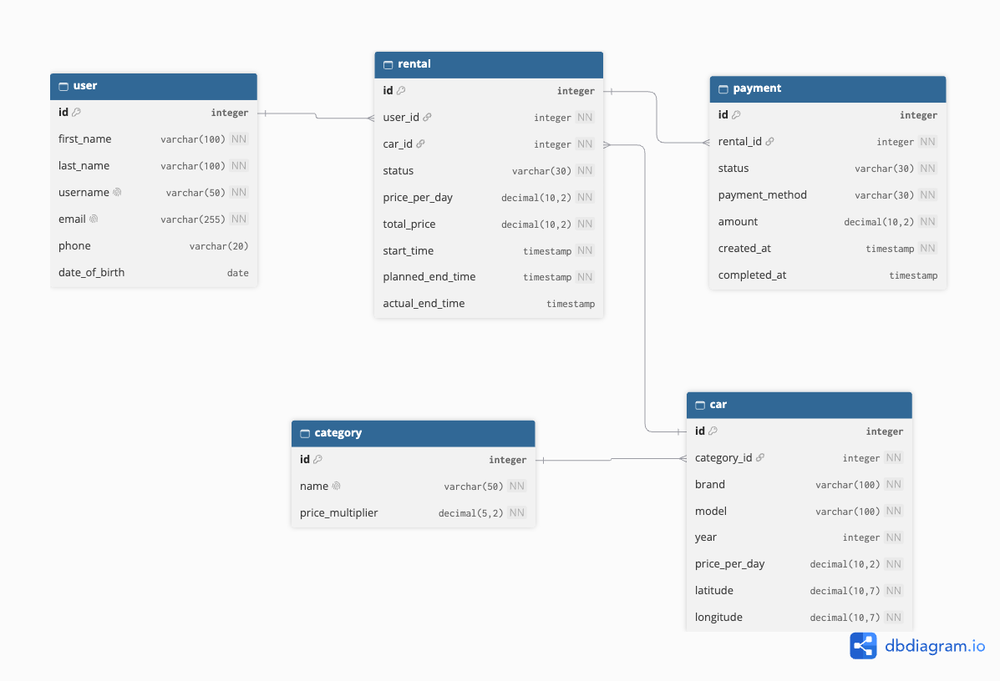

# car-rental



# Car Rental --- API Endpoints

Base URL: `http://localhost:8080`

All request and response bodies use JSON
(`Content-Type: application/json`, `Accept: application/json`).

## Users

Method Endpoint

---

POST `/users`
GET `/users`
GET `/users/{id}`
PATCH `/users/{id}`
DELETE `/users/{id}`
GET `/users/{id}/rentals`
GET `/users/{id}/payments`

### POST `/users`

```json
{
  "firstName": "John",
  "lastName": "Smith",
  "username": "johnsmith",
  "email": "john@example.com",
  "phone": "+358401234567",
  "dateOfBirth": "1998-05-15"
}
```

### PATCH `/users/{id}`

All fields are optional. Only supplied fields are updated.

```json
{
  "firstName": "John",
  "lastName": "Smith",
  "email": "john.smith@example.com",
  "phone": "+358401234567"
}
```

## Categories

Method Endpoint

---

GET `/categories`
GET `/categories/{id}`
POST `/categories`
PATCH `/categories/{id}`
DELETE `/categories/{id}`
GET `/categories/{id}/cars`

### POST `/categories`

```json
{
  "name": "BUSINESS",
  "priceMultiplier": 1.5
}
```

### PATCH `/categories/{id}`

All fields are optional. Only supplied fields are updated.

```json
{
  "name": "PREMIUM",
  "priceMultiplier": 1.75
}
```

## Cars

Method Endpoint

---

GET `/cars`
GET `/cars/{id}`
POST `/cars`
PUT `/cars/{id}`
PATCH `/cars/{id}`
DELETE `/cars/{id}`
GET `/cars/{id}/rentals`

### POST `/cars`

```json
{
  "categoryId": 2,
  "brand": "BMW",
  "model": "M5",
  "year": 2024,
  "pricePerDay": 100.0,
  "latitude": 60.1699,
  "longitude": 24.9384
}
```

### PUT `/cars/{id}`

Full replacement. All required fields must be supplied.

```json
{
  "categoryId": 2,
  "brand": "BMW",
  "model": "M5",
  "year": 2024,
  "pricePerDay": 110.0,
  "latitude": 60.1699,
  "longitude": 24.9384
}
```

### PATCH `/cars/{id}`

Partial update. Only supplied fields are updated.

```json
{
  "pricePerDay": 110.0,
  "latitude": 60.1701,
  "longitude": 24.9388
}
```

### GET `/cars` query parameters

All parameters are optional and can be combined.

- `categoryId`
- `brand`
- `minPrice`
- `maxPrice`
- `year`
- `latitude`
- `longitude`
- `radiusKm`
- `startTime`
- `endTime`
- `page`
- `size`
- `sort`

Example:

```text
/cars?categoryId=2&minPrice=50&maxPrice=150&page=0&size=20&sort=pricePerDay,asc
```

## Rentals

Method Endpoint

---

POST `/rentals`
GET `/rentals`
GET `/rentals/{id}`
PATCH `/rentals/{id}`
POST `/rentals/{id}/cancel`
POST `/rentals/{id}/start`
POST `/rentals/{id}/complete`
GET `/rentals/{id}/payments`

### POST `/rentals`

Authentication is not implemented in the MVP, so `userId` is supplied in
the request.

```json
{
  "userId": 10,
  "carId": 15,
  "startTime": "2026-12-01T10:00:00Z",
  "plannedEndTime": "2026-12-03T10:00:00Z"
}
```

### PATCH `/rentals/{id}`

Only permitted rental parameters may be updated. Status, calculated
prices, user ID and car ID must not be changed through this endpoint.

```json
{
  "startTime": "2026-12-01T12:00:00Z",
  "plannedEndTime": "2026-12-04T12:00:00Z"
}
```

### GET `/rentals` query parameters

All parameters are optional and can be combined.

- `userId`
- `carId`
- `status`
- `startDate`
- `endDate`
- `page`
- `size`

Example:

```text
/rentals?userId=10&status=ACTIVE&page=0&size=20
```

### Rental actions

The following endpoints do not require a request body:

- `POST /rentals/{id}/cancel`
- `POST /rentals/{id}/start`
- `POST /rentals/{id}/complete`

## Payments

Method Endpoint

---

POST `/payments`
GET `/payments`
GET `/payments/{id}`
GET `/payments/{id}/status`
GET `/rentals/{id}/payments`
POST `/payments/{id}/refund`

### POST `/payments`

The backend obtains the payment amount and user through the associated
rental. Do not send `userId` or `amount`.

```json
{
  "rentalId": 42,
  "paymentMethod": "CREDIT_CARD"
}
```

### POST `/payments/{id}/refund`

Full refund. No request body is required in the initial MVP.

### GET `/payments` query parameters

All parameters are optional.

- `rentalId`
- `status`
- `paymentMethod`
- `page`
- `size`

Example:

```text
/payments?rentalId=42&status=COMPLETED&page=0&size=20
```

## Date and Time Format

Use ISO 8601 date-time values with timezone information.

Example:

```text
2026-12-01T10:00:00Z
```

Use `LocalDate` for date-only values such as `dateOfBirth`, and
`Instant` or `OffsetDateTime` for timestamps.

## Enums

### RentalStatus

- `PENDING`
- `ACTIVE`
- `COMPLETED`
- `CANCELLED`

### PaymentStatus

- `PENDING`
- `COMPLETED`
- `FAILED`
- `REFUNDED`

### PaymentMethod

- `CREDIT_CARD`
- `DEBIT_CARD`
- `PAYPAL`
- `CASH`
